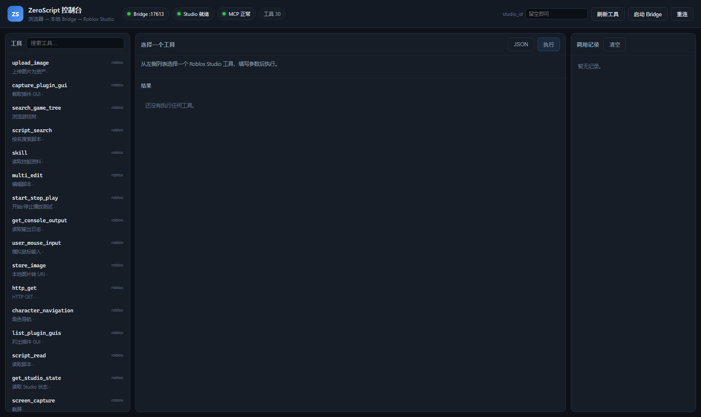

# ZeroScript for DeepSeek Harness

> Drive **Roblox Studio** from the **DeepSeek Harness (DSH)** agent.
> This plugin turns the local ZeroScript bridge into a first-class DSH plugin:
> 28+ Studio tools as DSH tools, a standalone web console, a GUI panel —
> **no browser extension, no chat web page, no terminal window.**



<p align="center">
  
  
  
  
</p>

> 中文文档见 [README.md](README.md)。

> Repository: <https://github.com/Century-Ula/mspd-ms> ·
> Download: <https://github.com/Century-Ula/mspd-ms/releases/latest> ·
> Issues: <https://github.com/Century-Ula/mspd-ms/issues>

---

## Why

ZeroScript normally drives Studio from an AI chat page through a browser extension:

```
AI chat page ── browser extension ── local bridge (ws://127.0.0.1:17613) ── Studio MCP ── Roblox Studio
```

Inside DSH the model *is* the agent, so the chat page and the extension are dead weight.
The valuable part is the bridge — a stable local WebSocket service that already aggregates
Roblox's Studio MCP tool catalog. This plugin is simply its second client:

```
DSH agent ──▶ this plugin ──ws://127.0.0.1:17613──▶ bridge.py ──▶ Studio MCP ──▶ Roblox Studio
```

The ZeroScript checkout is never modified; the plugin only talks to it over loopback.

---

## Features

| Capability | Detail |
|---|---|
| **28+ Studio tools** | read/edit scripts, run Luau, search the game tree, inspect instances, play-test, capture screenshots, search/insert assets, generate meshes/materials — all registered as `roblox_*` DSH tools |
| **3 always-on tools** | `roblox_status`, `roblox_list_tools`, `roblox_call` (raw escape hatch) |
| **Web console** | `http://127.0.0.1:19387/zeroscript` — status lights, tool catalog, schema-driven forms, call log, inline screenshots |
| **DSH sidebar panel** | same API, rendered inside the DSH GUI |
| **Windowless auto-start** | the plugin launches `bridge.py` in a hidden console — no terminal window to keep open |
| **Self-healing** | a dead bridge is respawned after ~15 s (measured: 33 s end-to-end, Studio reconnects automatically) |
| **Four-layer Studio detection** | process → MCP attach → place loaded → **real tool call**, fused into one verdict |
| **Multi-Studio aware** | tells the agent to pass `studio_id` when several Studios are attached |
| **Multi MCP aggregation** | add servers to `config.json` and their tools appear automatically |
| **Headless DCC (optional)** | drive Blender / 3ds Max directly, export models, optionally upload to Roblox via Open Cloud |
| **Zero DSH-internal imports** | only Node built-ins, so DSH upgrades cannot break it on a renamed package |

---

## Requirements

| Requirement | Version |
|---|---|
| OS | **Windows 10/11** (windowless launch uses `wscript`; other platforms untested) |
| DeepSeek Harness | **0.2.0-rc.2+** desktop build |
| ZeroScript-Free | **1.5.5** (for `bridge.py`) |
| Python | **3.9+** with `websockets` |
| Roblox Studio | built-in MCP enabled (one-time: Assistant AI → … → Manage MCP Servers → Enable Studio as MCP server) |

---

## Install

### 1. Get the pieces

- This plugin, e.g. `C:\Tools\dsh-zeroscript`.
- [ZeroScript-Free 1.5.5](https://github.com/sebattfg/ZeroScript-Free/releases), e.g. `D:\下载\文件\ZeroScript-Free-1.5.5`.
  The launcher auto-discovers installs by version; override with the `bridgeDir` option if needed.

### 2. Run the installer

```powershell
powershell -ExecutionPolicy Bypass -File .\install.ps1
```

It is idempotent and backs up `cordis.patch.yml` before touching it. It will:

1. link this folder to `<profile>\node_modules\dsh-zeroscript` (junction);
2. insert/update the loader entry (with a cache-busting `?m=N`) in `<profile>\cordis.patch.yml`.

Options: `-DryRun`, `-Profile desktop`, `-SkipLink`, `-DshHome <path>`.

### 3. Restart DSH and verify

Restart DeepSeek Harness, refresh the DSH page (F5), then:

```powershell
curl http://127.0.0.1:19387/zeroscript-version
curl http://127.0.0.1:19387/zeroscript/api/status
```

Console: <http://127.0.0.1:19387/zeroscript> — all three status lights green means ready.
No `start.bat` is needed: the bridge is started hidden by the plugin.

Manual install instructions are in the [Chinese README](README.md#安装教程).

### Uninstall

```powershell
powershell -ExecutionPolicy Bypass -File .\uninstall.ps1
```

Removes the patch entry and the junction (with a backup). Your plugin folder and ZeroScript are untouched.

---

## Usage

Just ask the agent, e.g.:

> Put a 10×1×10 red plastic Part in Workspace.

> Read the main script in ServerScriptService and set the player jump height to 60.

> Start play mode and check the console for errors.

> Screenshot this model so we can check the lighting.

Console (tools + status): <http://127.0.0.1:19387/zeroscript>

---

## Configuration

Set under the patch entry's `config:` (see `cordis.patch.example.yml`):

| Field | Default | Meaning |
|---|---|---|
| `port` | `17613` | bridge port (`ZS_BRIDGE_PORT`) |
| `bridgeDir` | `""` | folder containing `bridge.py`; empty = auto-discover newest |
| `autoLaunch` | `true` | spawn the bridge hidden when it is not running |
| `exposeTools` | `all` | one DSH tool per Studio tool; `generic` keeps only the 3 always-on tools |
| `toolPrefix` | `roblox_` | tool name prefix |
| `toolCallTimeoutMs` | `120000` | per-call timeout |
| `statusPollMs` | `5000` | status polling interval |
| `blender` / `max` / `zbrush` | `""` | explicit DCC executables |
| `openCloudKey` | `""` | Roblox Open Cloud key for asset upload (prefer `ROBLOX_OPEN_CLOUD_KEY`) |
| `creatorUserId` / `creatorGroupId` | `""` | asset owner (prefer env vars) |

---

## Troubleshooting

- `logs/startup.log` is written at module load time — it is the only channel that survives
  every failure mode. A loader entry showing `active` does **not** prove the plugin runs.
- `node tools/verify-detect.mjs 17613` runs the detection ladder outside DSH.
- `curl http://127.0.0.1:19387/zeroscript/api/host` shows mounted services and the client module graph.
- Multiple Studios open? Every Studio tool then needs `studio_id`; list them with
  `roblox_list_roblox_studios`.
- After changing `lib/`, bump `?m=N` in the patch entry; if DSH's HMR queue is stuck, restart DSH.

---

## Verified environment

Windows 11 (10.0.26200) · DSH 0.2.0-rc.2 · Node v24.18.1 (bundled) · ZeroScript-Free 1.5.5 ·
Python 3.11.0 + websockets 17.0.1 · Roblox Studio with 28 MCP tools.
Real calls verified (`get_studio_state`, `list_roblox_studios`, `execute_luau`), plus hidden
auto-start and a 33 s crash-healing test.

---

## License

MIT — see [LICENSE](LICENSE).
ZeroScript-Free itself is GPL-3.0-or-later by its authors; this plugin only communicates with it
over a local WebSocket and neither copies nor redistributes its code.
